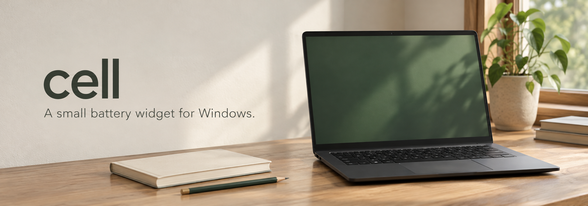
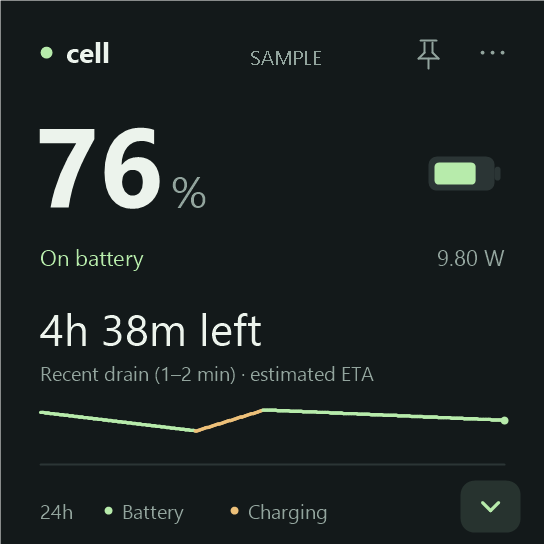
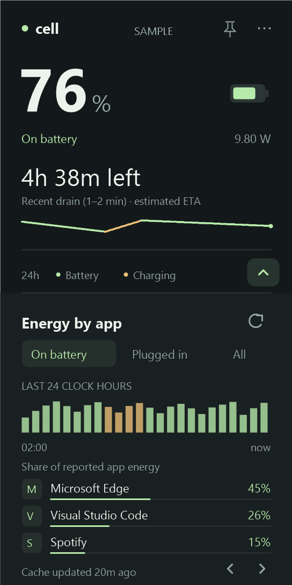
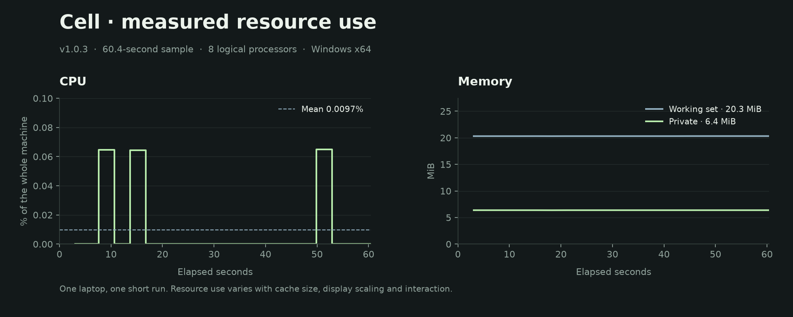

Battery level, a labelled runtime estimate, and Windows' app-energy history in one small native desktop widget.

**[Download Cell for Windows x64](downloads/CellBattery.zip?raw=1)** · [Usage and setup](docs/USAGE.md) · [Measured results](docs/VERIFICATION.md) · [Source](source/CellBattery.cpp)

Cell is for laptop work: a quick battery check while studying, watching a lecture, or moving between desks. It stays compact, can sit with your desktop icons, and expands only when you want the details.

## A small view, with details underneath

<table><tr><td valign="top" width="50%"><strong>Compact</strong><br><br></td><td valign="top" width="50%"><strong>Expanded downward</strong><br><br></td></tr></table>

Interface images are rendered by Cell itself with clearly labelled sample data. They show the actual layout, not generated UI mockups.

| What you can check | How it works |
| --- | --- |
| Battery level and power state | Native Windows readings, refreshed about every 2 seconds while visible |
| Time left | Windows ETA when available; otherwise a clearly labelled recent-drain estimate |
| Energy by app and hour | Windows' existing app-energy records, with battery and plugged-in filters |
| A clean desktop | About 218 × 218 px at 100% scaling; details extend downward at the same width |
| Desktop pin | Keep Cell behind normal app windows, alongside desktop icons |
| Hourly history | Optional one-time admin setup; subsequent hourly and on-demand refreshes run without prompts |

## Measured resource use



In a **60.4-second sample** on an 8-logical-processor Windows laptop, version **1.0.3** averaged **0.0097% CPU across the machine**, with **6.4 MiB private memory** and a **20.3 MiB working set** at the final sample. The executable is **310.5 KiB**.

These are observations from one short run, not fixed limits. The working set includes shared code and library pages. History export temporarily uses additional resources. [Method and limitations](docs/VERIFICATION.md) · [Sanitized measurements](verification/performance.json)

Cell uses native C++ and Win32/GDI+: one resident widget process, a blocking message loop, no browser engine, no process scans, and no continuous tracing. Drawing buffers and fonts are reused; routine updates repaint only changed regions. Sampling stops when the screen is off, the session is locked, or Windows suspends.

## Get started

1. [Download the portable ZIP](downloads/CellBattery.zip?raw=1) and extract it to a writable folder.
2. Open **CellBattery.exe**. Drag the title to position it; use the arrow for details and the pin for desktop mode.
3. For automatic app history, run **Enable-hourly-history.cmd** once and approve Windows' setup prompt. Future refreshes use Task Scheduler silently, including the refresh button. No password is stored and the task does not wake your laptop.
4. Optionally enable **Start with Windows** from the **…** menu.

Battery display works without hourly setup. Without setup, manual app-history exports require administrator consent. To remove the hourly task, run **Disable-hourly-history.cmd**. The widget itself always runs as a normal user.

## Understand the estimates

Wattage and remaining time are estimates from the battery's reporting. Recent drain averages roughly 1–2 minutes and needs warmup; it is not an instantaneous electrical meter. Changing your workload changes the estimate. App percentages represent shares of Windows' reported app-energy estimates, not percentage points of battery charge. Windows may publish those records late; unattributed energy stays separate. [Details](docs/USAGE.md)

## Build and verify

Windows x64, MSVC C++ Build Tools, and a Windows SDK are needed to build. No additional runtime is needed to run the compiled widget.

```powershell
.\source\build-msvc.ps1 -BuildDirectory .\build -WithIcon
Start-Process .\CellBattery.exe -ArgumentList '--self-test "build\checks"' -Wait
```

**56 native checks passed**, plus actual desktop attachment/detachment and silent scheduled-refresh checks. [Full verification](docs/VERIFICATION.md)

The header illustration was generated with AI. Interface renders and performance charts were produced separately from the application and measured data. [Visual provenance](docs/VISUALS.md)
