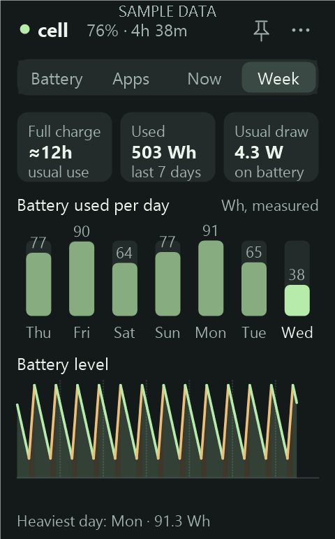
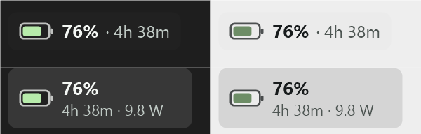

Battery level, a labelled runtime estimate, and Windows' app-energy history in one small native desktop widget.

**[Download Cell for Windows x64](downloads/CellBattery.zip?raw=1)** · [Usage and setup](docs/USAGE.md) · [Measured results](docs/VERIFICATION.md) · [Source](source/CellBattery.cpp)

Cell is for laptop work: a quick battery check while studying, watching a lecture, or moving between desks. It lives in your taskbar as a small pill, opens as one compact card, and can sit with your desktop icons.

## One card, four tabs, and a taskbar pill

<table><tr>
<td valign="top" width="33%"><strong>Battery</strong><br><br></td>
<td valign="top" width="33%"><strong>Apps</strong><br><br></td>
<td valign="top" width="33%"><strong>Week</strong><br><br></td>
</tr></table>



Interface images are rendered by Cell itself with clearly labelled sample data. They show the actual layout, not generated UI mockups.

| What you can check | How it works |
| --- | --- |
| Battery level and power state | Native Windows readings, refreshed about every 2 seconds while visible; red when low |
| Time left / time to full | Windows ETA when available; otherwise a clearly labelled recent-drain estimate. While charging, an estimated time to full |
| Battery health | Health (full-charge vs design capacity), stored energy and charge cycles |
| 24-hour battery curve | Hover any point to read the time, level and power state |
| Energy by app and hour | Windows' existing app-energy records in Wh and % of a charge, with app icons, a CPU/screen/network breakdown, filters, hour selection and a per-app hourly overlay |
| How much Windows explains | Cell measures the battery's real hourly loss and shows it next to what Windows attributed to apps |
| Right now | A live tab with battery draw over 5 minutes and the top apps by CPU time, no admin or waiting |
| Taskbar pill | Battery, percentage and time left beside the tray; hover for the full card, click to open Cell |
| Week | Measured battery use per day, your usual draw, and how long a full charge lasts at your usual use |
| Alerts (opt-in) | Unplug at 80%, low battery at 20%, and unusually high drain |
| A clean desktop | One fixed card, about 276 × 444 px at 100% scaling (Medium); Small and Large sizes in the menu; follows light or dark mode |
| Desktop pin | Keep Cell behind normal app windows, alongside desktop icons |
| Hourly history | Optional one-time admin setup; subsequent hourly and on-demand refreshes run without prompts |

## What's new in 1.4

- **Full visual rework:** a ring gauge, a live draw sparkline, a time-left range, and tabs (Battery, Apps, Now, Week) in one fixed card instead of a tall drop-down. Larger text, three sizes, light and dark themes.
- **Taskbar pill:** Cell sits in the taskbar next to the tray; hover for the card, click to open it. It adapts to taskbar height and theme and falls back to the tray icon when the taskbar can't host it.
- **Better readings:** since-unplug change, how long a full charge lasts at your usual use (from measured drain), and a more readable 24-hour curve that bridges sleep gaps with a dashed line instead of leaving fragments.
- **Week tab** and **opt-in alerts**.
- **Fix:** buttons no longer show classic grey bevels on their edges.

## What's new in 1.3

- **Measured drain vs. Windows' estimates:** Cell now records how much energy the battery really loses each hour and draws it as an outline behind the app bars. Windows' per-app records can cover only a small part of real drain (on the development laptop as little as 7% in one hour), and the panel now says so instead of implying app shares explain everything.
- **Absolute and detailed app energy:** Wh per app, "% of a full charge", and where an app's energy went (CPU, screen, network, disk, GPU) when Windows reports it. Executables of one product are merged.
- **Now tab:** live battery draw and top apps by CPU time over the last 30 s, sampled only while the tab is open.
- **Honest freshness:** the footer shows the newest Windows record ("data through 16:00"), not just when the cache was refreshed.

## What's new in 1.2

- **Energy by app redesign:** app icons from Windows, readable names, a segmented filter, five apps per page, hover readouts on the hourly chart, and click-an-app to see when it used energy.
- **More battery detail:** health, stored energy and cycle tiles; time to full while charging; "charging paused" when a charge limit holds the battery; low-battery colouring.
- **Live tray percentage** and a hoverable 24-hour battery curve with a complete legend.
- **Fixes:** history no longer breaks into fragments while hidden; plugged-in is blue everywhere (amber only means charging); a refresh can no longer get stuck if Explorer restarts; no permanent "warming up" label on batteries that cannot report a drain trend.

## Measured resource use


In a **60.4-second sample** on an 8-logical-processor Windows laptop, version **1.0.3** averaged **0.0097% CPU across the machine**, with **6.4 MiB private memory** and a **20.3 MiB working set** at the final sample. The executable is **310.5 KiB**.

These are observations from one short run, not fixed limits. The working set includes shared code and library pages. History export temporarily uses additional resources. [Method and limitations](docs/VERIFICATION.md) · [Sanitized measurements](verification/performance.json)

Cell uses native C++ and Win32/GDI+: one resident widget process, a blocking message loop, no browser engine, no process scans, and no continuous tracing. Drawing buffers and fonts are reused; routine updates repaint only changed regions. Sampling stops when the screen is off, the session is locked, or Windows suspends.

## Get started

1. [Download the portable ZIP](downloads/CellBattery.zip?raw=1) and extract it to a writable folder.
2. Open **CellBattery.exe**. Cell appears in your taskbar and as a card; drag the card's title to move it, switch tabs for details, and use the pin for desktop mode.
3. For automatic app history, run **Enable-hourly-history.cmd** once and approve Windows' setup prompt. Future refreshes use Task Scheduler silently, including the refresh button. No password is stored and the task does not wake your laptop.
4. Optionally enable **Start with Windows** from the **…** menu.

Battery display works without hourly setup. Without setup, manual app-history exports require administrator consent. To remove the hourly task, run **Disable-hourly-history.cmd**. The widget itself always runs as a normal user.

## Understand the estimates

Wattage and remaining time are estimates from the battery's reporting. Recent drain averages roughly 1–2 minutes and needs warmup; it is not an instantaneous electrical meter. Changing your workload changes the estimate. App percentages represent shares of Windows' reported app-energy estimates, not percentage points of battery charge. Windows may publish those records late; unattributed energy stays separate. [Details](docs/USAGE.md)

## Build and verify

Windows x64, MSVC C++ Build Tools, and a Windows SDK are needed to build. No additional runtime is needed to run the compiled widget.

```powershell
.\source\build-msvc.ps1 -BuildDirectory .\build -WithIcon
Start-Process .\CellBattery.exe -ArgumentList '--self-test "build\checks"' -Wait
```

**84 native checks passed** in version 1.4.0, plus actual desktop attachment/detachment and silent scheduled-refresh checks. [Full verification](docs/VERIFICATION.md)

The header illustration was generated with AI. Interface renders and performance charts were produced separately from the application and measured data. [Visual provenance](docs/VISUALS.md)
